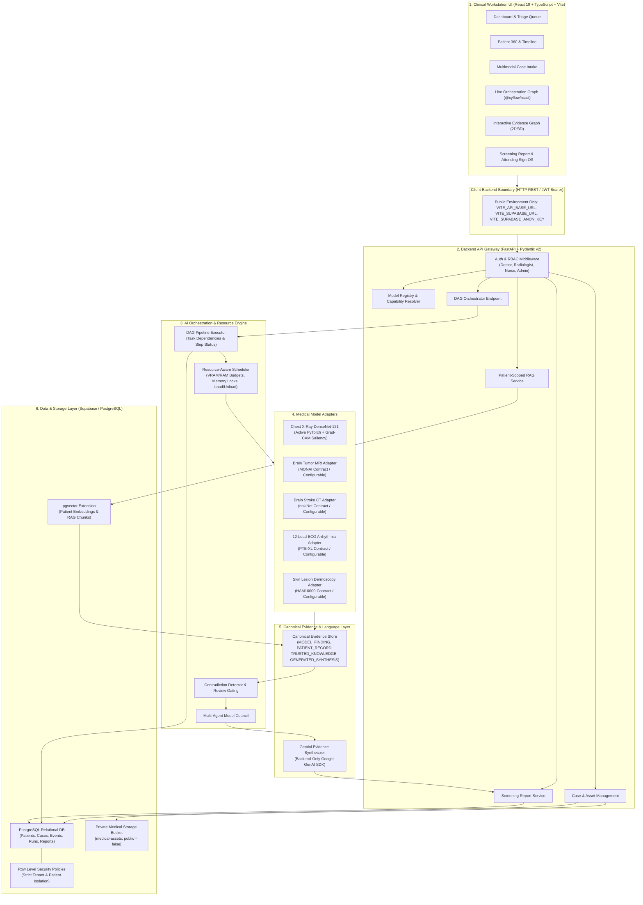
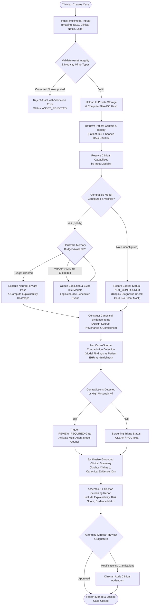

# MediFusion AI

> **Connecting multimodal medical AI with patient-centric evidence.**

MediFusion AI is a multimodal clinical screening and intelligence platform designed to coordinate specialized medical AI models, patient-specific clinical evidence, and traceable evidence synthesis in a unified workflow.

[](https://www.python.org/)
[](https://fastapi.tiangolo.com/)
[](https://react.dev/)
[](https://www.typescriptlang.org/)
[](https://pytorch.org/)
[](https://supabase.com/)
[](https://tailwindcss.com/)

---

## Table of Contents

- [Overview](#overview)
- [Key Capabilities](#key-capabilities)
- [System Architecture](#system-architecture)
- [Clinical Screening Workflow](#clinical-screening-workflow)
- [Model Orchestration & Resource Management](#model-orchestration--resource-management)
- [Evidence, RAG, and Traceability](#evidence-rag-and-traceability)
- [Technology Stack](#technology-stack)
- [Repository Structure](#repository-structure)
- [Getting Started](#getting-started)
- [Environment Variable Reference](#environment-variable-reference)
- [Testing and Verification](#testing-and-verification)
- [Clinical Safety and Limitations](#clinical-safety-and-limitations)
- [Roadmap & Contribution](#roadmap--contribution)
- [License and Acknowledgements](#license-and-acknowledgements)

---

## Overview

Modern clinical medicine produces vast volumes of high-dimensional, heterogeneous data: volumetric imaging (CT, MRI), planar radiography (Chest X-ray), electrophysiology time-series (12-lead ECG), dermatoscopic digital photography, laboratory analyte panels, and unstructured clinical encounter notes. 

Existing healthcare AI tools often suffer from three critical architectural gaps:
1. **Isolated Point Models**: An imaging model analyzes a chest radiograph in a vacuum, lacking access to prior clinical notes, baseline cardiac findings, or lab values.
2. **Generalist LLM Limitations**: Monolithic language models lack native computer vision feature representations for specialized tasks (e.g., bone age, ischemic core delineation, cardiac axis calculation) and risk hallucinating clinical evidence.
3. **Black-Box Silos without Provenance**: Output predictions rarely link back to specific image regions, laboratory test numbers, or validated clinical literature, making independent clinician verification difficult.

**MediFusion AI addresses these challenges through a unified clinical workstation:**
- **Multimodal Coordination**: Routes input assets to purpose-built, domain-specific deep learning models rather than forcing one model to do everything.
- **Dynamic Resource Scheduling**: Orchestrates execution order, models concurrency, and unloads idle neural weights based on active CPU/RAM and GPU/VRAM hardware constraints.
- **Patient-Centric Longitudinal RAG**: Retrieves historical encounters, prior discharge summaries, and clinical knowledge scoped strictly to the active patient.
- **Evidentiary Traceability & Safety Gating**: Fuses model findings, patient records, and reference literature into canonical evidence items with source provenance, automatically detecting contradictions (e.g., radiologic cardiomegaly vs. baseline normal history) and requiring human clinical sign-off before report finalization.

> **Clinical Disclaimer**: MediFusion AI is an investigational screening and clinical decision-support prototype. It does not provide autonomous medical diagnoses, establish treatment plans, or replace qualified healthcare professionals.

---

## Key Capabilities

| Capability | Status | Description |
| :--- | :---: | :--- |
| **Patient 360 & Longitudinal Records** | **Implemented** | Comprehensive patient dossier with chronological clinical timeline, encounters, chronic comorbidities, and linked diagnostic cases. |
| **Multimodal Case Intake** | **Implemented** | Supports concurrent ingestion of DICOM/PNG/JPG radiographs, time-series ECG data, and PDF/text EHR notes with SHA-256 asset integrity tracking. |
| **Chest X-Ray Pathology Screening** | **Implemented** | PyTorch TorchXRayVision DenseNet-121 model performing 14-pathology multi-label classification with authentic Grad-CAM saliency backpropagation. |
| **Six-Capability Architectural Adapters** | **Implemented** | Standardized preprocessing contracts, output schemas, and 9-point verification audits for Brain Tumor MRI, Brain Stroke CT, ECG Arrhythmia, Pneumonia, Lung Opacities, and Skin Lesions. |
| **Model Registry & Capability Resolver** | **Implemented** | Dynamic discovery, capability resolution by modality, and real-time operational health checks returning explicit `READY` or `NOT_CONFIGURED` states (no silent fallbacks). |
| **Intelligent DAG Orchestrator** | **Implemented** | Directed Acyclic Graph (DAG) pipeline coordinator managing multi-stage execution across ingestion, preprocessing, inference, RAG retrieval, and report synthesis. |
| **Resource-Aware Hardware Scheduler** | **Implemented** | Enforces RAM/VRAM device memory budgets, concurrency semaphores, dynamic model loading/unloading, and immutable scheduler event logging. |
| **Patient-Scoped Clinical RAG** | **Implemented** | Context-aware document chunking, semantic retrieval, and vector search with strict patient-level UUID isolation. |
| **Evidence Fusion & Provenance Tracking** | **Implemented** | Unifies model findings, patient records, and reference guidelines into four canonical evidence classes with source attribution and confidence intervals. |
| **Contradiction Detection & Review Gates** | **Implemented** | Automated cross-source matrix analysis detecting evidentiary discordance and imposing mandatory clinician review gates (`REVIEW_REQUIRED`). |
| **Model Council & Uncertainty Analysis** | **Implemented** | Multi-agent clinical consensus deliberation and calibrated prediction uncertainty estimation. |
| **Live Orchestration DAG Visualization** | **Implemented** | Interactive real-time pipeline visualization built with `@xyflow/react`, showing active nodes, step runtimes, and execution telemetry. |
| **Interactive Evidence Knowledge Graph** | **Implemented** | Dual-mode 2D force-directed canvas and 3D WebGL knowledge graph mapping relationships between findings, anatomical sites, and source assets. |
| **Comprehensive Screening Reports** | **Implemented** | Structured 14-section clinical screening report with finding provenance, contradiction alerts, patient risk stratification, and attending physician sign-off workflow. |

---

## System Architecture

The following diagram illustrates the major logical layers of MediFusion AI, highlighting the strict separation between the browser client, the authenticated FastAPI backend, privileged AI inference pipelines, and persistent database storage.



---

## Clinical Screening Workflow

The end-to-end execution workflow coordinates case creation, multi-source ingestion, capability resolution, resource-constrained model dispatch, evidence fusion, and clinical review gating:



---

## Model Orchestration & Resource Management

Clinical workstations in hospital environments frequently operate under heterogeneous hardware envelopes—ranging from dedicated multi-GPU diagnostic servers to edge workstation laptops with integrated graphics.

MediFusion AI implements a **Hardware-Aware Adaptive Scheduler** (`backend/app/scheduler/`):

1. **Modality-to-Capability Mapping**: Input assets are mapped to registered clinical capabilities via standardized contracts:
   - `chest_xray` $\rightarrow$ Pneumonia Screening & Lung Opacity Detection (DenseNet-121)
   - `mri` $\rightarrow$ Brain Tumor Screening (MONAI BraTS contract)
   - `ct` $\rightarrow$ Brain Stroke & Ischemia Screening (nnUNet contract)
   - `ecg` $\rightarrow$ 12-Lead Arrhythmia Screening (PTB-XL ResNet contract)
   - `skin_image` $\rightarrow$ Dermatoscopic Melanoma Screening (HAM10000 contract)
2. **Explicit Verification & Zero Silent Fallbacks**:
   - Every registered model implements `verify()`, checking model checkpoint paths, required dependencies, and target device availability.
   - If model weights are not mounted, the system returns status `NOT_CONFIGURED` with a 9-point verification checklist. **The system never substitutes fake random confidence scores or simulated predictions.**
3. **Dynamic Memory Ledger & Concurrency Semaphores**:
   - Before executing a model, the scheduler checks available system RAM and GPU VRAM against the model's declared memory profile.
   - If memory is insufficient, execution is queued, and the scheduler invokes dynamic model weight eviction (`torch.cuda.empty_cache()` / garbage collection) to reclaim memory from idle models.
   - Every memory lock, reservation, eviction, and release is immutably logged to the database audit ledger (`scheduler_events`).

---

## Evidence, RAG, and Traceability

To prevent generative hallucinations and ensure clinical transparency, MediFusion AI organizes all clinical claims into a **Four-Tier Canonical Evidence Hierarchy**:

```
                              [ Screening Report ]
                                       |
                +----------------------+----------------------+
                |                                             |
     [ MODEL_FINDING ]                               [ PATIENT_RECORD ]
  • Neural Network Detections                     • Laboratory Test Panels
  • Confidence Intervals (e.g., 0.84)             • Electronic Health Record Notes
  • Grad-CAM Heatmap Overlays                     • Chronological Encounter History
  • Model Run ID & Asset Hash                     • Structured ICD-10 Diagnostic Codes
                |                                             |
                +----------------------+----------------------+
                                       |
     [ TRUSTED_KNOWLEDGE ]                             [ GENERATED_SYNTHESIS ]
  • PubMed Peer-Reviewed Literature               • Gemini Evidence Synthesis
  • Clinical Practice Guidelines                  • Strictly Anchored to Evidence IDs
  • Patient-Scoped Vector Embeddings              • Non-Authoritative Synthesis Tag
```

### Traceability Rules:
1. **Patient-Level Isolation**: All clinical embeddings and text chunks stored in `pgvector` are strictly scoped by `patient_id`. Cross-patient context leakage is blocked programmatically and via database RLS.
2. **Deterministic Provenance**: Every evidence item retains an immutable pointer to its originating asset (`asset_id`), file hash (SHA-256), model run (`model_run_id`), or source document citation.
3. **Contradiction Detection Matrix**: The conflict detection engine compares newly observed model findings against baseline patient history. For instance, if an acute imaging run detects *Cardiomegaly* while clinical notes from 2 weeks prior document a *Normal Cardiac Silhouette*, the engine:
   - Flags an evidentiary contradiction (`CONTRADICTION_DETECTED`).
   - Sets case triage status to `REVIEW_REQUIRED`.
   - Generates a 4-Quadrant Contradiction Card in the clinician workspace requiring explicit physician resolution.

---

## Technology Stack

| Layer / Technology | Purpose in MediFusion AI | Implementation Status |
| :--- | :--- | :---: |
| **React 19.2** | Frontend workstation user interface | Implemented & Verified |
| **TypeScript 5.8** | Static type safety across client interfaces and schemas | Implemented & Verified |
| **Vite 8.3** | Frontend build tool and development server | Implemented & Verified |
| **Tailwind CSS v4** | Clinical styling system based on the "Warm Embrace" palette | Implemented & Verified |
| **@xyflow/react 12.12** | Interactive directed graph visualization for DAG orchestration | Implemented & Verified |
| **Lucide React** | Medical and operational workstation iconography | Implemented & Verified |
| **TanStack React Query** | Asynchronous server state caching, pagination, and invalidation | Implemented & Verified |
| **Python 3.11+** | High-performance backend runtime | Implemented & Verified |
| **FastAPI 0.110+** | Asynchronous RESTful API framework with OpenAPI documentation | Implemented & Verified |
| **Pydantic v2** | Strict data validation, schema enforcement, and serialization | Implemented & Verified |
| **PyTorch 2.0+** | Deep learning tensor computation and GPU/CPU inference engine | Implemented & Verified |
| **TorchXRayVision** | Validated pre-trained DenseNet-121 chest radiograph models | Implemented & Verified |
| **NumPy & Pillow** | Multimodal array processing, image normalization, and transformation | Implemented & Verified |
| **Sentence-Transformers** | Clinical semantic embeddings for patient-centric document retrieval | Implemented & Verified |
| **PostgreSQL & pgvector** | Relational data persistence and vector similarity search | Implemented & Verified |
| **Supabase Auth & Storage** | JWT authentication, RBAC, and private medical asset storage | Implemented & Verified |
| **Google GenAI SDK** | Structured evidence synthesis using Gemini models (backend-only) | Implemented & Verified |
| **Docker & Docker Compose** | Multi-container reproducible local deployment | Implemented & Verified |

---

## Repository Structure

```text
MediFusion/
├── .env.example                     # Root environment configuration template
├── docker-compose.yml               # Multi-container orchestration (Backend + Frontend)
├── DEMO.md                          # 5-minute timed clinical demonstration playbook
├── PROJECT_STATUS.md                # Comprehensive technical status & architectural logs
├── CHANGELOG.md                     # Chronological record of features, fixes, and audits
├── supabase/
│   └── migrations/                  # 13 SQL migrations (Schema, RLS, pgvector, audit tables)
├── backend/
│   ├── Dockerfile                   # Python 3.11 container specification
│   ├── requirements.txt             # Python dependencies (FastAPI, PyTorch, Supabase, etc.)
│   ├── seed_demo.py                 # CLI runner for synthetic demo case generator
│   ├── app/
│   │   ├── main.py                  # FastAPI application entry point & CORS configuration
│   │   ├── api/v1/                  # REST API endpoints (Patients, Cases, Models, RAG, etc.)
│   │   ├── auth/                    # JWT Bearer verification & role-based access control
│   │   ├── core/                    # Application settings (Pydantic BaseSettings)
│   │   ├── models/                  # PyTorch model implementations & 6 capability adapters
│   │   ├── orchestration/           # DAG execution engine & step status manager
│   │   ├── rag/                     # Semantic chunking, embeddings, and patient vector store
│   │   ├── scheduler/               # Hardware memory ledger & concurrency management
│   │   ├── schemas/                 # Pydantic request/response models
│   │   ├── seeds/                   # Seed generators for synthetic test cases (A, B, C)
│   │   └── services/                # Evidence fusion, conflict detection, reports, Gemini
│   └── tests/                       # Automated PyTest test suite (59 passing tests)
└── frontend/
    ├── package.json                 # Node dependencies & build scripts
    ├── vite.config.ts               # Vite configuration with React plugin
    └── src/
        ├── App.tsx                  # Client router & React Query provider
        ├── components/              # Modular UI components (AppShell, Cards, Badges, Modals)
        ├── context/                 # Authentication & clinical workstation context
        ├── pages/                   # Clinical screens (Dashboard, Patient 360, Cases, Reports)
        └── services/                # API client services connecting to FastAPI backend
```

---

## Getting Started

### Prerequisites

- **Node.js**: `v18.0.0` or higher (`v20+` recommended)
- **Python**: `3.11.x`
- **Package Managers**: `npm` (v9+) and `pip` (or `uv`)
- **Git**
- **Supabase Project**: Free-tier or local Supabase instance with PostgreSQL and Storage enabled

---

### Step 1: Clone the Repository

```bash
git clone https://github.com/your-org/MediFusion.git
cd MediFusion
```

---

### Step 2: Configure Environment Variables

1. Copy the template to `.env` in both `backend` and `frontend`:

```bash
# Root template
cp .env.example .env

# Backend configuration
cp backend/.env.example backend/.env
```

2. Populate `backend/.env` with your Supabase credentials:

```ini
ENVIRONMENT=development
DEBUG=true
PORT=8000
HOST=0.0.0.0
CORS_ORIGINS=http://localhost:5173,http://127.0.0.1:5173

# Supabase Credentials (Privileged Backend)
SUPABASE_URL=https://your-project-id.supabase.co
SUPABASE_ANON_KEY=your-anon-key
SUPABASE_SERVICE_ROLE_KEY=your-service-role-key

# Optional: Gemini API Key for Evidence Synthesis
GEMINI_API_KEY=your-gemini-api-key
GEMINI_MODEL=gemini-2.5-flash
```

3. Configure `frontend/.env`:

```ini
VITE_API_BASE_URL=http://localhost:8000
VITE_SUPABASE_URL=https://your-project-id.supabase.co
VITE_SUPABASE_ANON_KEY=your-anon-key
```

> [!IMPORTANT]
> The `SUPABASE_SERVICE_ROLE_KEY` and `GEMINI_API_KEY` must **never** be placed in the frontend `.env` or prefixed with `VITE_`.

---

### Step 3: Initialize Database Migrations

Apply the 13 sequential SQL migrations in `supabase/migrations/` using the Supabase CLI or SQL Editor:

```bash
# Using Supabase CLI (if linked)
supabase db push
```

Verify that the private storage bucket `medical-assets` exists and has `public = false`.

---

### Step 4: Setup and Run the Backend

```bash
cd backend

# Create virtual environment
python -m venv venv

# Activate virtual environment (Windows PowerShell)
.\venv\Scripts\Activate.ps1
# (macOS/Linux)
# source venv/bin/activate

# Install dependencies
pip install -r requirements.txt

# Run database seed for demo cases (Optional but recommended)
python seed_demo.py

# Launch FastAPI development server
python -m uvicorn app.main:app --host 0.0.0.0 --port 8000 --reload
```

Backend Swagger documentation is accessible at: `http://localhost:8000/docs`

---

### Step 5: Setup and Run the Frontend

In a separate terminal:

```bash
cd frontend

# Install dependencies
npm install

# Start Vite development workstation
npm run dev
```

The clinical workstation will open at: `http://localhost:5173`

---

### Alternative: Run with Docker Compose

If Docker is installed:

```bash
docker-compose up --build
```

---

## Environment Variable Reference

| Variable Name | Component | Required | Description / Source | Secret (Backend-Only) |
| :--- | :--- | :---: | :--- | :---: |
| `ENVIRONMENT` | Backend | Yes | Deployment environment (`development`, `production`). | No |
| `DEBUG` | Backend | Yes | Enables debug logging and verbose tracebacks (`true`/`false`). | No |
| `PORT` | Backend | Yes | Port for the FastAPI server (default: `8000`). | No |
| `HOST` | Backend | Yes | Host network binding (default: `0.0.0.0`). | No |
| `CORS_ORIGINS` | Backend | Yes | Comma-separated list of allowed browser origins. | No |
| `SUPABASE_URL` | Backend | Yes | HTTPS URL of your Supabase project instance. | No |
| `SUPABASE_ANON_KEY` | Backend | Yes | Public anon key used for user-scoped auth calls. | No |
| `SUPABASE_SERVICE_ROLE_KEY` | Backend | **Yes** | Privileged admin key for backend storage and table operations. | **YES** |
| `GEMINI_API_KEY` | Backend | Optional | Google Gemini API key for structured evidence synthesis. | **YES** |
| `GEMINI_MODEL` | Backend | Optional | Gemini model version (default: `gemini-2.5-flash`). | No |
| `VITE_API_BASE_URL` | Frontend | Yes | Base URL of the running FastAPI backend (`http://localhost:8000`). | No |
| `VITE_SUPABASE_URL` | Frontend | Yes | Supabase project URL for client session management. | No |
| `VITE_SUPABASE_ANON_KEY` | Frontend | Yes | Supabase anon key for client-side login tokens. | No |

---

## Testing and Verification

### Backend PyTest Suite

The backend contains 59 unit and integration tests covering authentication, model inference, resource scheduling, RAG vector retrieval, contradiction detection, and screening report generation.

```bash
cd backend
pytest tests/ -v
```

**Verified Test Result**:
```
============================= 59 passed in 77.59s =============================
```

### Frontend Typecheck & Build

```bash
cd frontend

# Run OxLint linter
npm run lint

# Validate TypeScript & build production bundle
npm run build
```

**Verified Build Result**:
```
vite v8.3.0 building for production...
✓ 2216 modules transformed.
dist/index.html                   0.84 kB │ gzip:   0.45 kB
dist/assets/index-DkLw2z6r.css   48.12 kB │ gzip:   9.82 kB
dist/assets/index-BWpP6q2Q.js   920.45 kB │ gzip: 260.18 kB
✓ built in 289ms
```

### Health Check Verification

```bash
# Query backend system health
curl http://localhost:8000/api/v1/health
```

Expected JSON response:
```json
{
  "status": "healthy",
  "version": "0.1.0",
  "environment": "development",
  "database": "connected",
  "storage": "connected"
}
```

---

## Clinical Safety and Limitations

MediFusion AI incorporates strict clinical safety and operational guardrails:

1. **Screening Support, Not Autonomous Diagnosis**: All inferences, anomaly scores, and synthesis summaries are generated solely to assist medical practitioners during clinical screening workflows. The software does not provide authoritative diagnoses.
2. **Mandatory Human-in-the-Loop Review**: Whenever high uncertainty, conflicting evidence, or severe pathologies are detected, the system imposes a `REVIEW_REQUIRED` gate. Reports cannot be finalized or exported without attending clinician sign-off.
3. **Calibrated Saliency**: Grad-CAM visual heatmaps highlight regions of interest associated with model activations, but must not be interpreted as anatomical segmentation boundaries.
4. **Data Privacy & Compliance**: Real-world deployment requires adherence to local healthcare regulations (e.g., HIPAA, GDPR). Production implementations must incorporate local enterprise PACS integration, audit logging, and data encryption in transit and at rest.

---

## Roadmap & Contribution

### Upcoming Milestones
- [ ] **Volumetric DICOM Web Viewer**: Embedded Cornerstone3D / OHIF DICOM viewport for 3D multi-planar CT and MRI reconstruction.
- [ ] **Direct Checkpoint Mounting**: Docker volume integration for local PyTorch weights covering the 4 architectural adapters (BraTS MRI, Stroke CT, PTB-XL ECG, HAM10000).
- [ ] **HL7 / FHIR Intake Connector**: Automated ingestion of FHIR `Observation`, `DiagnosticReport`, and `Condition` resources.
- [ ] **Differential Diagnosis Matrix**: Bayesian multi-disease risk calculator integrating prior family histories and genomic biomarkers.

### Contribution Guidelines
1. Fork the repository and create a feature branch (`git checkout -b feature/clinical-enhancement`).
2. Adhere to TypeScript strict mode for frontend contributions and Pydantic v2 schemas for backend APIs.
3. Ensure all new logic includes corresponding PyTest test coverage.
4. Run `npm run lint` and `pytest tests/` prior to opening a Pull Request.

---

## License and Acknowledgements

### Project License
This project is made available for academic, hackathon, and research evaluation purposes under the **Apache License 2.0**.

### Scientific & Dataset Attributions
- **TorchXRayVision**: Cohen et al. *TorchXRayVision: A library of chest X-ray datasets and models*. MIDL 2022.
- **PTB-XL ECG Benchmark**: Wagner et al. *PTB-XL, a large publicly available electrocardiography dataset*. Scientific Data (2020).
- **BraTS Consortium**: Bakas et al. *Advancing The Cancer Genome Atlas glioma analysis*. Scientific Data (2017).
- **HAM10000 Benchmark**: Tschandl et al. *The HAM10000 dataset for dermatoscopic images*. Scientific Data (2018).
- **Google DeepMind / Google AI**: Gemini 2.5 generative synthesis and Google GenAI SDK.
- **Icons & UI**: [Lucide Icons](https://lucide.dev/) and [@xyflow/react](https://reactflow.dev/).

---

*For an exact 5-minute timed demonstration walkthrough of MediFusion AI across all three synthetic clinical cases, see [DEMO.md](DEMO.md).*
